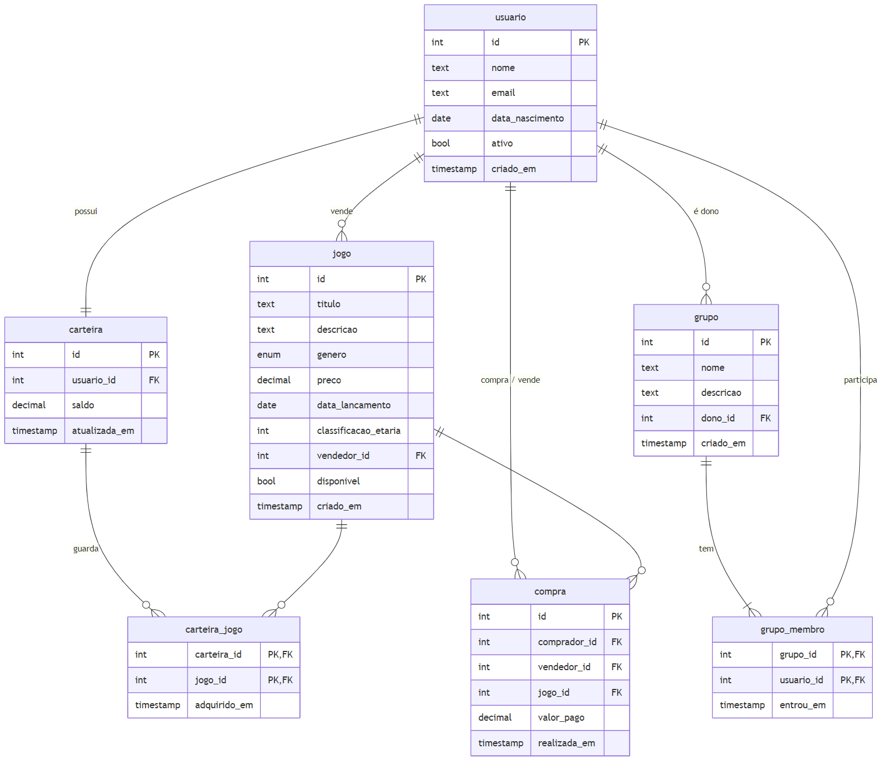

# GameHub API

Microsserviço RESTful de uma **plataforma de jogos digitais**, feito com **FastAPI**, ORM
**SQLModel** (sobre SQLAlchemy) e banco **PostgreSQL** rodando em Docker.

Usuários compram e vendem jogos, guardam os jogos comprados em uma carteira e podem formar
grupos de até 5 pessoas para compartilhar suas bibliotecas. Toda compra fica registrada em um log.

> 🎥 **Vídeo de demonstração:** https://youtu.be/D6yUcJoKS0o

## Tecnologias

- Python 3.10+
- [FastAPI](https://fastapi.tiangolo.com/): framework web e documentação automática (Swagger)
- [SQLModel](https://sqlmodel.tiangolo.com/): ORM baseado em SQLAlchemy e Pydantic
- [PostgreSQL 17](https://www.postgresql.org/) em container Docker, acessado pelo driver `psycopg` 3
- `pydantic-settings`: leitura das credenciais a partir do `.env`

## Modelo relacional



As tabelas são criadas pelo script [`sql/criar_tabelas.sql`](sql/criar_tabelas.sql), que o
container do Postgres executa sozinho na primeira inicialização. O diagrama é gerado a partir de
[`docs/modelo_relacional.mmd`](docs/modelo_relacional.mmd) (Mermaid).

## Como executar

Pré-requisitos: **Docker** (com Docker Compose) e **Python 3.10+**. Rode todos os comandos na raiz
do repositório.

**1. Configure as credenciais.** O `.env` não vai para o Git; o `.env.example` serve de modelo.

```bash
cp .env.example .env        # no PowerShell: Copy-Item .env.example .env
```

Abra o `.env` e troque `POSTGRES_PASSWORD` por uma senha sua.

**2. Suba o PostgreSQL no Docker.** Na primeira vez, o container executa o
`sql/criar_tabelas.sql` e cria todas as tabelas.

```bash
docker compose up -d
```

**3. Instale as dependências em um ambiente virtual.**

```bash
python -m venv .venv
source .venv/bin/activate   # no PowerShell: .venv\Scripts\Activate.ps1
pip install -r requirements.txt
```

**4. (Opcional) Popule o banco com dados de exemplo:** 8 usuários, 6 jogos, 7 compras e o grupo
"Família Souza", já com 5 membros.

```bash
python -m app.seed
```

**5. Inicie a API.**

```bash
uvicorn app.main:app --reload
```

## Estrutura do projeto

```
.
├── app/
│   ├── main.py            # criação da aplicação FastAPI e registro das rotas
│   ├── config.py          # configurações lidas do .env
│   ├── database.py        # engine do SQLAlchemy e sessão por requisição
│   ├── comum.py           # paginação e helpers de erro (404/409)
│   ├── seed.py            # dados de exemplo (python -m app.seed)
│   ├── models/            # modelos do ORM (SQLModel), um arquivo por entidade
│   ├── routers/           # rotas HTTP, um arquivo por recurso
│   └── services/          # regras de negócio transacionais (compra, entrada em grupo)
├── sql/
│   └── criar_tabelas.sql  # script que cria as tabelas do banco
├── docs/                  # diagrama do modelo relacional
├── docker-compose.yml     # container do PostgreSQL
├── requirements.txt
└── .env.example           # modelo das variáveis de ambiente
```

A documentação interativa fica em **http://localhost:8000/docs** (Swagger)

## Uso de IA
Agente de IA: Claude Opus 5.5

- Documentação de commits e particionamento de trabalho.
- Criação da imagem do modelo relacional usando mermaid.
- Criação da seed para popular o banco e postman da API REST.
- Criação do README